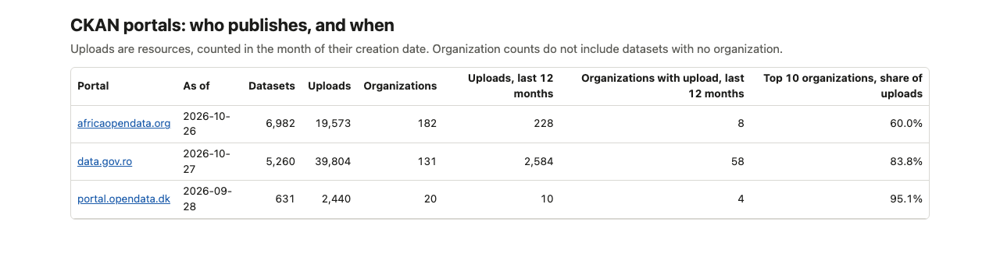
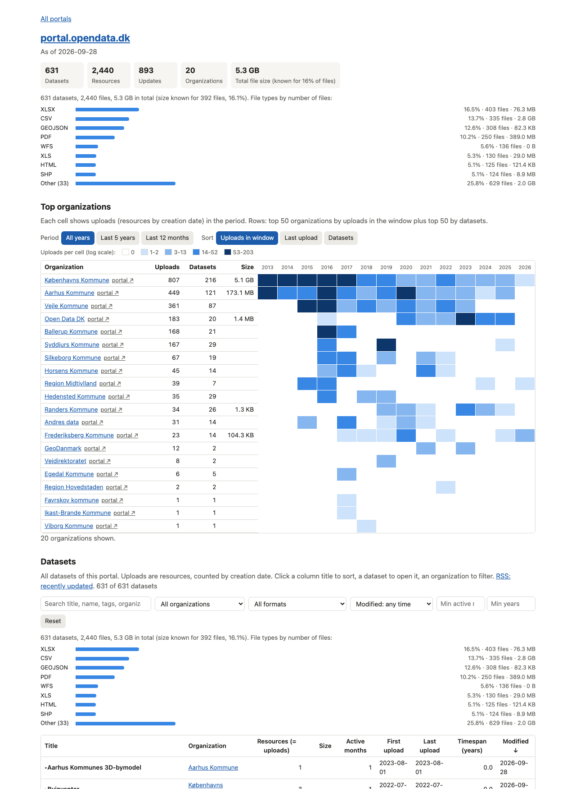
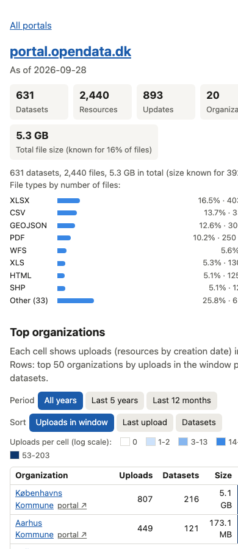

# CKAN Explorer

Python scripts that collect dataset metadata from public CKAN open-data portals. They show
who publishes, and when. Background: [CKAN data analyzer](https://docs.google.com/document/d/1Emrco1IWSVUrHCGGPlFBf8qqCEucECJi/).

All scripts use the standard library, except `fetch-datasets.py` (needs `requests` and `tqdm`).

## What you get

An index page lists the portals with their key numbers.



Each portal page shows totals, file types, a heatmap of uploads per organization and month,
and one filterable list of all datasets.



The pages also work on a phone.



## Quick start

```sh
python fetch-datasets.py https://portal.opendata.dk    # -> data/portal.opendata.dk/
python org-stats.py --all                              # -> data/<host>/stats/
python report.py                                       # -> site/index.html, site/<host>.html
open site/index.html
```

`data/` is not tracked by git. The large `site/*-datasets.js` files are not tracked either.

## Scripts

| Script | Purpose |
| --- | --- |
| `fetch-datasets.py <url> [--out DIR]` | Pages through `package_search`. Writes `package-stats.csv` and `datasets.jsonl` to `data/<hostname>/`. |
| `org-stats.py <data/host>... \| --all [--as-of YYYY-MM-DD]` | Reads `datasets.jsonl`. Writes `orgs.csv`, `org-monthly.csv`, `datasets.csv` and `summary.json` to `data/<host>/stats/`. |
| `report.py [--data DIR] [--out DIR]` | Builds the static HTML pages, the dataset data files and one RSS feed per portal. |
| `snapshot.py <data/host>... \| --all [--force]` | Writes a slim, dated snapshot to `data/<host>/snapshots/`. |
| `diff-snapshots.py OLD NEW` | Lists the datasets added, deleted and changed between two snapshots. |
| `portal-probe.py` | Checks whether candidate portals have a working CKAN API. |
| `list-packages.py`, `get-stats.py` | Legacy, slow. Use `fetch-datasets.py` instead. |

Run the tests with `python -m unittest discover tests`.

## Metric

An upload is a resource, counted in the month of its `created` date. See `docs/specs/` for
the full specifications and `docs/ANALYSIS.md` for the measurements behind this choice.

## Known limits

- `data.gov.md`, `data.gov.sg` and `datastore.brussels` do not offer a CKAN API.
- Many resources have no `size`. Size totals are lower bounds.
- `catalog.data.gov` has more than 300,000 datasets. Do not fetch it.

## More

- `docs/BACKLOG.md` - open tasks and bugs.
- `docs/ACTIVITY.md` - dated log of the work.
- `docs/RELEASES.md` - version history.
